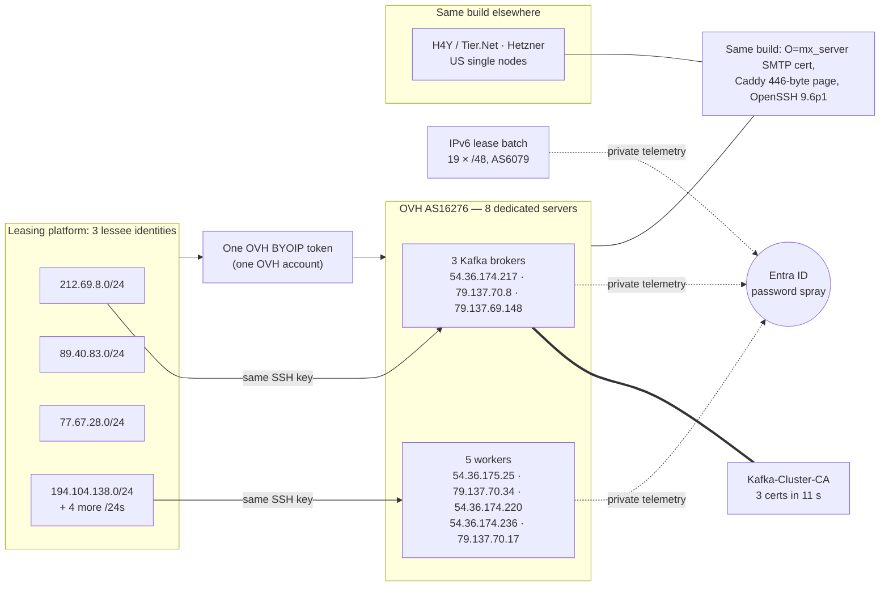

# mx_server Fleet — From Leased IPs to the Operator's Servers


> Independent OSINT analysis of a templated mail-server fleet that rents its address space instead of owning it. Eight IPXO-leased /24s sit in **one OVH account** through Bring Your Own IP (BYOIP). **v2.0 maps every one of them to the physical OVH server behind it**, exposes a three-broker Kafka backend, proves a single scripted deployment, and ties two fleet servers to Microsoft Entra ID password-spray traffic.

| | |
|---|---|
| **Analysis window** | Scan data 2026-10-21 to 2026-11-23. Registry and DNS history back to 2025-10 |
| **Fleet status** | The 8 OVH servers answer on their native IPs on 2026-11-23. The leased fronts went dark on 2026-11-12 |
| **Operator identity / nationality** | Attribution not supported |
| **Release** | Sanitized public release, **v2.0** (2026-11-23). v1.0: 2026-11-20 |

---

## What's new in v2.0

| | Novel contribution | Reusable technique |
|---|---|---|
| 🖥️ | **8 leased /24s → 8 OVH servers.** Identical SSH host keys on front and native IPs | [SSH host-key mapping](methodology/ssh-hostkey-front-to-server-mapping.md) |
| 📨 | **A Kafka backend.** 3 brokers, 5 workers. Broker certificates minted by one script in 11 s; serial `…b7:4f` missing | [Serial-sequence pivot](methodology/certificate-serial-sequence-pivot.md) |
| ⏱️ | **One scripted deployment.** The same page written on two hosts 10.2 s apart, recovered from Caddy ETags | [Caddy ETag forensics](methodology/caddy-etag-forensics.md) |
| 🔎 | **New fleet nodes.** A web body-hash sweep (246 hosts, 50 apex domains) found `reedjordan.com` and a new Hetzner node | [Body-hash sweep](methodology/web-body-hash-sweep.md) |
| 🎯 | **Spray traffic tied to hardware.** Two fleet servers, one a Kafka broker, appear in private password-spray telemetry | [Spray infrastructure](docs/spray-infrastructure.md) |
| 🧩 | **One IPv6 lease order.** Spray exits fall in 19 /48s created in the IRR within 13 s | [IRR batch clustering](methodology/irr-route-object-batch-clustering.md) |
| 🧪 | **Sandbox artifact caught.** A public sandbox's proxy, not the target, answered on 80/443 | [Sandbox egress artifacts](methodology/sandbox-egress-artifacts.md) |
| 🛠️ | **Six stdlib Python tools with tests** | [`tools/`](tools/) |

v1.0 contributions (BYOIP token clustering, SOA serial decoding, the Kafka CA fingerprint, a Shodan false positive) are still here. Full list: [`docs/novel-contributions.md`](docs/novel-contributions.md).

## The fleet at a glance



## Headline findings

**Every leased /24 runs on one OVH server (NOVEL).** Seven of eight fronts present the exact SSH host key of an OVH dedicated server. The eighth matches by elimination. Two unique OpenSSH patch levels confirm two pairs independently. → [`docs/server-map.md`](docs/server-map.md)

**A Kafka cluster sits at the core (NOVEL).** Three servers run Java Kafka with a private CA. All three broker certificates were minted between 15:37:01 and 15:37:12 UTC on 2026-08-17, with one serial skipped. The listener accepts TLS from anyone, with no client certificate. → [`docs/kafka-backend.md`](docs/kafka-backend.md)

**One script built the web layer (NOVEL).** Decoded Caddy ETags show the same 446-byte page written on a new node and on a broker 10.2 seconds apart on 2026-07-29. → [`methodology/caddy-etag-forensics.md`](methodology/caddy-etag-forensics.md)

**The fleet carries password-spray traffic (NOVEL).** Two front addresses in private Entra ID telemetry map, by SSH key, to a broker (54.36.174.217) and a worker (54.36.175.25). The fleet carries spray traffic: **likely**, moderate confidence. Whether the servers run the spray or relay it: **roughly even chance**, low confidence. → [`docs/spray-infrastructure.md`](docs/spray-infrastructure.md)

**Spray exits come from one IPv6 lease order (NOVEL).** A second toolset leaves through IPv6 /48s that all fall inside one 19-prefix IRR batch created in 13 seconds. → [`methodology/irr-route-object-batch-clustering.md`](methodology/irr-route-object-batch-clustering.md)

**Nationality is not supported (null result).** 86 operator events show no working day in any time zone and no weekend pause. → [`docs/pattern-of-life.md`](docs/pattern-of-life.md)

## For defenders: start here

| Need | Go to |
|---|---|
| What to block, hunt and harden, on one page | [`docs/defender-advisory.md`](docs/defender-advisory.md) |
| The 8 durable server IPs | [`iocs/servers.csv`](iocs/servers.csv) |
| Defender XDR hunts H1–H9 | [`detections/kql-hunts.md`](detections/kql-hunts.md) |
| Sigma rules (6) | [`detections/sigma/`](detections/sigma/) |
| Suricata rules (5) | [`detections/suricata/mx-server-fleet.rules`](detections/suricata/mx-server-fleet.rules) |
| STIX 2.1 bundle (427 objects) | [`stix/mx-server-fleet.json`](stix/mx-server-fleet.json) |
| ATT&CK mapping and Navigator layer | [`docs/mitre-attack.md`](docs/mitre-attack.md) |

## For analysts: how it was done

| Need | Go to |
|---|---|
| Full write-up (Parts 1 and 2) | [`docs/technical-analysis.md`](docs/technical-analysis.md) |
| Pivot chain, step by step | [`methodology/pivot-methodology.md`](methodology/pivot-methodology.md) |
| Shodan · Censys · FOFA · Validin · passive DNS queries | [`queries/`](queries/) |
| Diamond model | [`docs/diamond-model.md`](docs/diamond-model.md) |
| Timeline | [`docs/timeline.md`](docs/timeline.md) |
| Leads that went nowhere | [`docs/closed-leads.md`](docs/closed-leads.md) |
| What I got wrong and fixed | [`docs/retraction-log.md`](docs/retraction-log.md) |
| Reproduce the numbers | [`tools/`](tools/) + [`data/`](data/) |

## Repository contents

```
mx-server-fleet-cti/
├── README.md · CHANGELOG.md · CITATION.cff · LICENSE (CC BY 4.0)
├── docs/
│   ├── technical-analysis.md                 full write-up, Parts 1 and 2
│   ├── server-map.md                         v2: 8 /24s → 8 OVH servers
│   ├── kafka-backend.md                      v2: brokers, CA run, TLS profile
│   ├── spray-infrastructure.md               v2: two toolsets, two exit layers
│   ├── pattern-of-life.md                    v2: nationality null result
│   ├── closed-leads.md                       v2: 10 tested and closed leads
│   ├── defender-advisory.md                  v2: block, hunt, harden
│   ├── mitre-attack.md · diamond-model.md    v2: frameworks
│   ├── novel-contributions.md                N1–N13
│   ├── timeline.md                           2025-10 to 2026-11, UTC
│   ├── retraction-log.md                     9 corrections + judgment changes
│   └── disclosure.md                         providers notified
├── methodology/                              10 technique write-ups
├── tools/                                    6 dependency-free Python tools
├── tests/                                    unit tests against case values
├── data/                                     raw observations behind each finding
├── iocs/                                     IPs, servers, netblocks, IPv6 ranges, domains, certs, web fingerprints
├── detections/
│   ├── kql-hunts.md                          9 Defender XDR hunts
│   ├── sigma/                                6 Sigma rules
│   └── suricata/                             5 Suricata rules
├── queries/                                  Censys, Shodan, FOFA, Validin, passive DNS
└── stix/mx-server-fleet.json                 STIX 2.1 bundle
```

## Fleet size by provider

| Provider | Hosts | Status on 2026-11-23 |
|---|---|---|
| OVH BYOIP (IPXO-leased, 8 × /24) | 1,894 | Dark since 2026-11-12 |
| H4Y Technologies (incl. Tier.Net reallocations) | 529 | Active to at least 2026-11-20 |
| Hetzner | 31 | Active to at least 2026-11-20 |
| OVH dedicated servers (behind the BYOIP fronts) | 8 | **Active** |
| OVH US single node (`reedjordan.com`) | 1 | Active |
| **Total** | **2,463** | |

## Confidence levels

| Judgment | Likelihood | Confidence |
|---|---|---|
| The eight BYOIP blocks belong to one OVH account | Very likely | Moderate-high |
| Each /24 runs on the OVH server mapped in `server-map.md` | Very likely | Moderate-high |
| One operator built all eight servers | Very likely | Moderate |
| The OVH, H4Y and Hetzner hosts are one fleet | Likely | Moderate |
| The fleet carries password-spray traffic | Likely | Moderate |
| The fleet servers run (not relay) the spray | Roughly even chance | Low |
| The Kafka brokers are the single "main" control asset | Unlikely | Low |
| Operator identity / nationality | Attribution not supported | — |

## What's NOT in this repository

- **No victim names, organizations, users, dates or log details.** Spray observations are cited as "private telemetry" without source, date or target.
- **No access to the operator's systems.** No Kafka client connection, no logins, no mail sent. Host data is passive scan data or public sandbox captures.
- **No private individuals.** People named in registry records are not named here.
- **No unrelated third parties.** Earlier tenants of fleet IPs and look-alike clusters are described, not named.

## IOC freshness

- **Most durable:** the 8 server IPs, SSH host keys, the Kafka CA key identifier, the `O=mx_server` format, the BYOIP token.
- **Least durable:** the leased /24s and IPv6 /48s. They can pass to new tenants. Block them for inbound mail and sign-ins, and set a review date.
- **Never block:** Cloudflare edge IPs that some fleet domains resolve to.

## Run the tools

```bash
python3 -m unittest discover -s tests          # 10 tests, stdlib only
python3 tools/caddy_etag.py '"dkb1fqjbnd35ce"' '"dkb1fv87lqycce"' --content-length 446
python3 tools/kafka_serial.py --gaps 17:94:5f:83:2a:ea:9b:90:27:ed:e5:c1:cb:9e:f5:32:ef:e6:b7:4e 17:94:5f:83:2a:ea:9b:90:27:ed:e5:c1:cb:9e:f5:32:ef:e6:b7:51
python3 tools/pattern_of_life.py data/operator_event_times_utc.txt
```

## Related work

- IPXO, ["How to Prepare Your Leased Subnet for OVH BYOIP"](https://www.ipxo.com/kb/technical-guides/how-to-prepare-your-leased-subnet-for-ovh-byoip/). Documents the token in the RIPE `descr` field.
- OVHcloud, ["Bring Your Own IP"](https://www.ovhcloud.com/en/network/byoip/).
- Spamhaus, ["A Snowshoe Winter"](https://www.spamhaus.org/resource-hub/spam/a-snowshoe-winter-our-discontent-with-can-spam/). Background on snowshoe tradecraft.
- Qurium, ["Volatile networks as a source of Denial of Service"](https://www.qurium.org/weaponizing-proxy-and-vpn-providers/volatile-networks/). Prior abuse of IPXO-leased prefixes.

## Citation

See [`CITATION.cff`](CITATION.cff).

## License

[CC BY 4.0](https://creativecommons.org/licenses/by/4.0/). Use, share and adapt with attribution.

## Responsible use

This repository documents live infrastructure for defense. Do not probe, log in to or attack the listed hosts, including the Kafka listeners. Passive lookups are fine. See [`docs/disclosure.md`](docs/disclosure.md) for the providers notified before release.

---

*Independent research by Yanky Wilson. Analytic standard: ICD-203 likelihood language, NOVEL / CORROBORATED / PUBLISHED / EXCLUDED source tags, a public retraction log, and null results reported as findings.*
