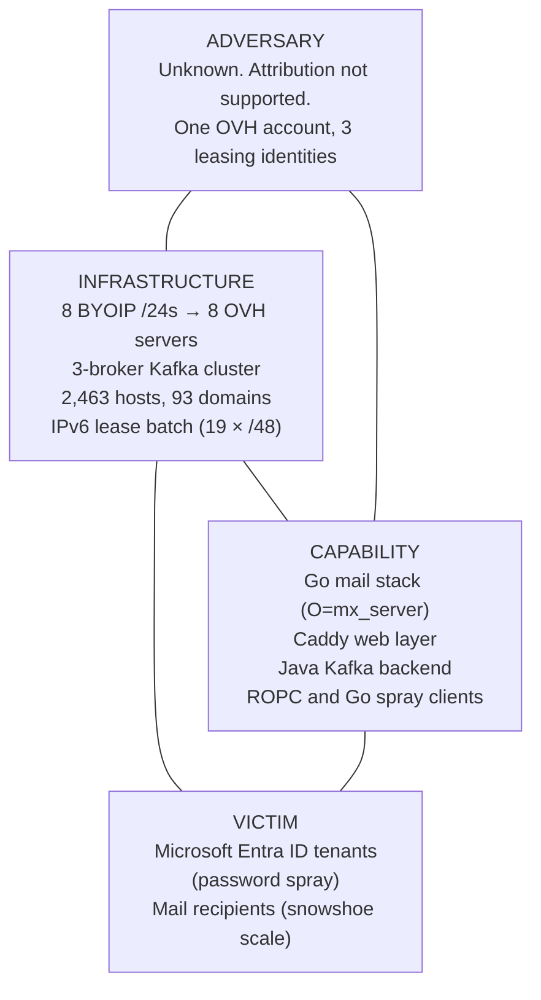

# Diamond model (v2.0)

| Vertex | What is known | Confidence |
|---|---|---|
| **Adversary** | One operator account at OVH. Scripted, 7-day activity. No language or national marker | Low on identity; moderate that it is one operator |
| **Infrastructure** | Fully mapped from front IP to physical server. See [`server-map.md`](server-map.md) | Moderate-high |
| **Capability** | Mail stack and web layer deployed by script on 2026-07-29. Kafka CA issued on 2026-08-17. Two spray toolsets | Moderate |
| **Victim** | Entra ID tenants. One private observation set. Mail recipients not observed | Low on breadth |

## Meta-features

| Feature | Value |
|---|---|
| Timestamp range | 2025-10 (first DNS edits) to 2026-11-23 (servers still live) |
| Phase | Resource development active; credential access attempted |
| Result | No successful sign-in observed |
| Direction | Infrastructure → victim |
| Methodology | Snowshoe distribution, leased address space, scripted deployment |
| Resources | Dedicated servers, leased IPv4 and IPv6, aged domains |

## Pivots that remain open

| From | To | Who can close it |
|---|---|---|
| Infrastructure | Adversary | OVH (account holder), the leasing platform (lessee), the registrars |
| Infrastructure | Capability | The hosting provider (contents of the Kafka topics) |
| Victim | Infrastructure | Other tenants that see the same exits |
