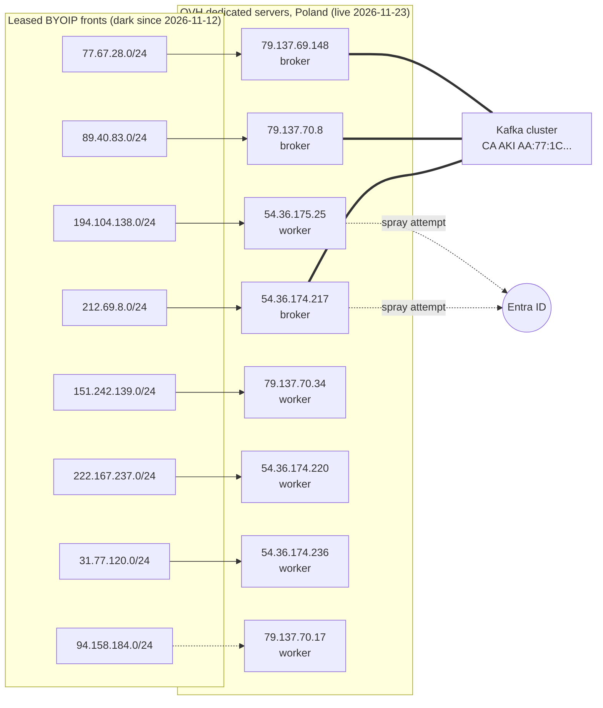

# Server map: 8 BYOIP /24s → 8 OVH dedicated servers (v2.0, NOVEL)

**Bottom line.** The eight leased /24s are not eight separate deployments. Each one is routed onto **one OVH dedicated server in Poland**. Seven of the eight mappings are proven by **identical SSH host keys** on the front address and the server's native address. The eighth is matched by elimination and an overlapping service-port block. Two of the servers carried password-spray traffic.

| Front /24 (BYOIP, IPXO-leased) | Server (OVH native IP) | Hostname | SSH key (MD5) | OpenSSH build | Role |
|---|---|---|---|---|---|
| 212.69.8.0/24 | **54.36.174.217** | tendersage.straightmembers.com | `d9:f9:6a:36:c3:48:25:87:4e:7d:7d:d3:d5:8b:23:af` | 3ubuntu13.20 | Kafka broker · spray source |
| 89.40.83.0/24 | **79.137.70.8** | ns3066510.ip-79-137-70.eu | `c1:04:d3:40:53:61:c6:d9:34:60:ae:bb:98:23:d3:c0` | 3ubuntu13.20 | Kafka broker |
| 77.67.28.0/24 | **79.137.69.148** | crispoak.roscoweb.com | `d5:7a:4e:ef:e7:14:6b:49:ed:8d:e6:e7:a2:94:c2:62` | 3ubuntu13.20 | Kafka broker |
| 194.104.138.0/24 | **54.36.175.25** | merryjasmine.mightenyip.com | `34:8f:68:2c:f2:b5:4f:47:cf:59:43:8b:b0:b3:b4:79` | 3ubuntu13.**19** | Worker · spray source |
| 151.242.139.0/24 | **79.137.70.34** | sagecastle.womandentists.com | `38:e8:b2:d0:af:94:21:c2:08:77:cb:51:4a:27:07:0b` | 3ubuntu13.**18** | Worker |
| 222.167.237.0/24 | **54.36.174.220** | sharpwolf.quadramail.com | `94:7b:22:79:cd:fa:3b:9b:d5:75:76:42:a0:51:36:75` | 3ubuntu13.20 | Worker |
| 31.77.120.0/24 | **54.36.174.236** | keendaisy.phoenixseniornews.com | `23:c1:42:51:a5:18:d7:00:c0:a6:b3:c8:c9:7f:f7:96` | 3ubuntu13.20 | Worker |
| 94.158.184.0/24 | **79.137.70.17** (by elimination) | darkcrest.listcellboard.com | not captured ("Exceeded MaxStartups") | — | Worker |

Machine-readable: [`../iocs/servers.csv`](../iocs/servers.csv). Raw observations: [`../data/ssh_hostkey_observations.csv`](../data/ssh_hostkey_observations.csv).

## Why an SSH host key proves the mapping

An OVH BYOIP range is delivered to a dedicated server as additional IPs. `sshd` listens on every address of the host and presents **the same host key** on all of them. A host key is generated per machine at install time. Two addresses that present the same ECDSA host key are, with near certainty, the same `sshd` on the same machine.

Each mapping was cross-checked with a second, independent signal:

| Mapping | Second signal |
|---|---|
| 212.69.8.0/24 → 54.36.174.217 | Fronts serve the Kafka certificate `CN=54.36.174.217` on 9092 |
| 89.40.83.0/24 → 79.137.70.8 | Fronts serve the Kafka certificate `CN=79.137.70.8`; both expose the same ~60-port block at 121xx–123xx |
| 77.67.28.0/24 → 79.137.69.148 | Fronts serve the Kafka certificate `CN=79.137.69.148` |
| 194.104.138.0/24 → 54.36.175.25 | OpenSSH patch level 3ubuntu13.19 on both, unique in the fleet; SHA-256 key `db3d5455…ac20` found by Censys on 194.104.138.210 |
| 151.242.139.0/24 → 79.137.70.34 | OpenSSH patch level 3ubuntu13.18 on both, unique in the fleet |
| 94.158.184.0/24 → 79.137.70.17 | Only server left; both expose high-port blocks in the same 123xx–125xx range |

## Spray sources

Two fleet front addresses appeared in Microsoft Entra ID password-spray telemetry from a private source. Source, dates and target are withheld. Both attempts used the Azure Active Directory PowerShell client and failed.

| Front address in telemetry | Server that sent it | Likelihood | Confidence |
|---|---|---|---|
| An address in 212.69.8.0/24 | 54.36.174.217 (Kafka broker) | Very likely | Moderate-high |
| An address in 194.104.138.0/24 | 54.36.175.25 (worker) | Very likely | Moderate-high |

What this does **not** show: whether software on those servers chose the target, or whether the servers relayed traffic for someone else. See [`spray-infrastructure.md`](spray-infrastructure.md).

## Status

- **Fronts:** the BYOIP /24s stopped serving fleet content on 2026-11-12 (Validin, Shodan).
- **Servers:** the eight servers still answered on their native IPs on 2026-11-23 (Shodan, Validin, FOFA).
- **Block the servers' native IPs.** They are the durable part of this layer.

## Assessment

- The eight /24s run on eight OVH dedicated servers, one per /24: **very likely**, moderate-high confidence.
- One operator built and runs all eight servers: **very likely**, moderate confidence (same build, same BYOIP token, same Kafka CA, same deployment run on 2026-07-29).
