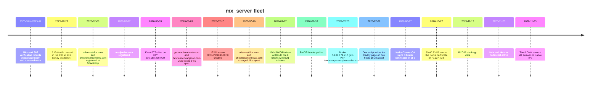

# Timeline (UTC)

| Date / time (UTC) | Event | Source |
|---|---|---|
| 1999-09-13 | `roscoweb.com` created | RDAP |
| 2004-09-13 | `godsbarn.com` created (later sold through an aftermarket) | RDAP, DNS history |
| 2005-09-14 | `calicater.com` created | RDAP |
| 2025-10-16 11:36 | IRR route6 objects 2602:fad4:10–14::/48 created (AS9009, MNT-DCL-577) | IRR |
| 2025-10 to 2025-12 | `MS=` verification TXT records on `godsbarn.com` (2) and `roscoweb.com` (1) | Passive DNS |
| 2025-12-17 20:17 | IRR route6 object 2602:fad4:16::/48 created (AS6079) | IRR |
| 2025-12-22 11:44:35 – 11:44:48 | **19 IRR route6 objects 2602:fad4:17–29::/48 created (AS6079)**. All observed spray exits fall here | IRR |
| 2026-02-06 15:54 / 22:37 | `adamsethfox.com` / `phoenixseniornews.com` registered at Spaceship | RDAP |
| 2026-02-11 10:19:01 | `2a0d:4b40::/29` registry object created (netutils-mnt) | RIPE |
| 2026-03-12 | `reedjordan.com` registered at Spaceship | RDAP |
| 2026-06-03/04 | Fleet PTRs on 216.158.220.0/24 (H4Y) | Passive DNS |
| 2026-06-09 12:57:53 / 12:58:47 | `devriendenvanjacob.com` / `gourmethazelnuts.com` DNS edits | Cloudflare SOA decoding |
| 2026-07-15 17:45:43 | IPXO lessee "Company 6a53796d6yVdFmVm" (ORG-PC1890-RIPE) created | RIPE |
| 2026-07-16 19:30:00 / 19:30:18 | `adamsethfox.com` / `phoenixseniornews.com` last registry change | RDAP |
| 2026-07-16 19:33:48 / 19:34:26 | Same two zones edited in DNS | Cloudflare SOA decoding |
| 2026-07-17 14:32:17 – 14:53:17 | OVH BYOIP token written to the eight blocks | RIPE version history |
| 2026-07-18 | BYOIP blocks begin serving the fleet | Routing history, scan data |
| 2026-07-25 | Broker 54.36.174.217 PTR changes to `tendersage.straightmembers.com` | Passive DNS |
| 2026-07-29 12:02:12.611 / 12:02:22.823 | Caddy page written on 15.204.194.100 and on broker 54.36.174.217, 10.2 s apart | Caddy ETag decoding |
| 2026-07-29 ~11:38 | `adamsethfox.com` SMTP certificate generated | Certificate validity |
| 2026-08-17 15:37:01 / :11 / :12 | Broker certificates for 79.137.69.148, 79.137.70.8, 54.36.174.217 issued; serial `…4f` skipped | Certificate validity |
| 2026-08-21 11:18:19 / 11:19:56 | `calicater.com` / `phoenixseniornews.com` DNS edits | Cloudflare SOA decoding |
| 2026-09-17 01:13 | IRR route6 2602:fad4:15::/48 created (AS6079, MAINT-AS11404) | IRR |
| 2026-10-19/20 | `godsbarn.com`, `calicater.com`, `roscoweb.com` last registry change (GoDaddy) | RDAP |
| 2026-10-20 07:53:36 | `reedjordan.com` DNS edit | Cloudflare SOA decoding |
| 2026-10-24 to 10-27 | High-port blocks (121xx–125xx) seen on 79.137.70.8 and 79.137.70.17 | Shodan |
| 2026-10-27 | 89.40.83.56:9092 serves the certificate for CN=79.137.70.8 | Shodan |
| 2026-11-11 22:02, 2026-11-12 02:05 | Last DNS edits before the BYOIP blocks go dark | Cloudflare SOA decoding |
| 2026-11-12 13:26 | Last scan response from 89.40.83.56 | Shodan |
| 2026-11-20 | 194.104.138.0/24 and 89.40.83.0/24 still announced by AS16276; H4Y and Hetzner nodes active | Routing data, scan data |
| 2026-11-16 | 54.36.175.25 seen active | Validin |
| 2026-11-23 | The 8 OVH servers answer on native IPs; BYOIP fronts still dark | Shodan, Validin |

Password-spray events from private telemetry are not dated here, to protect the source.
