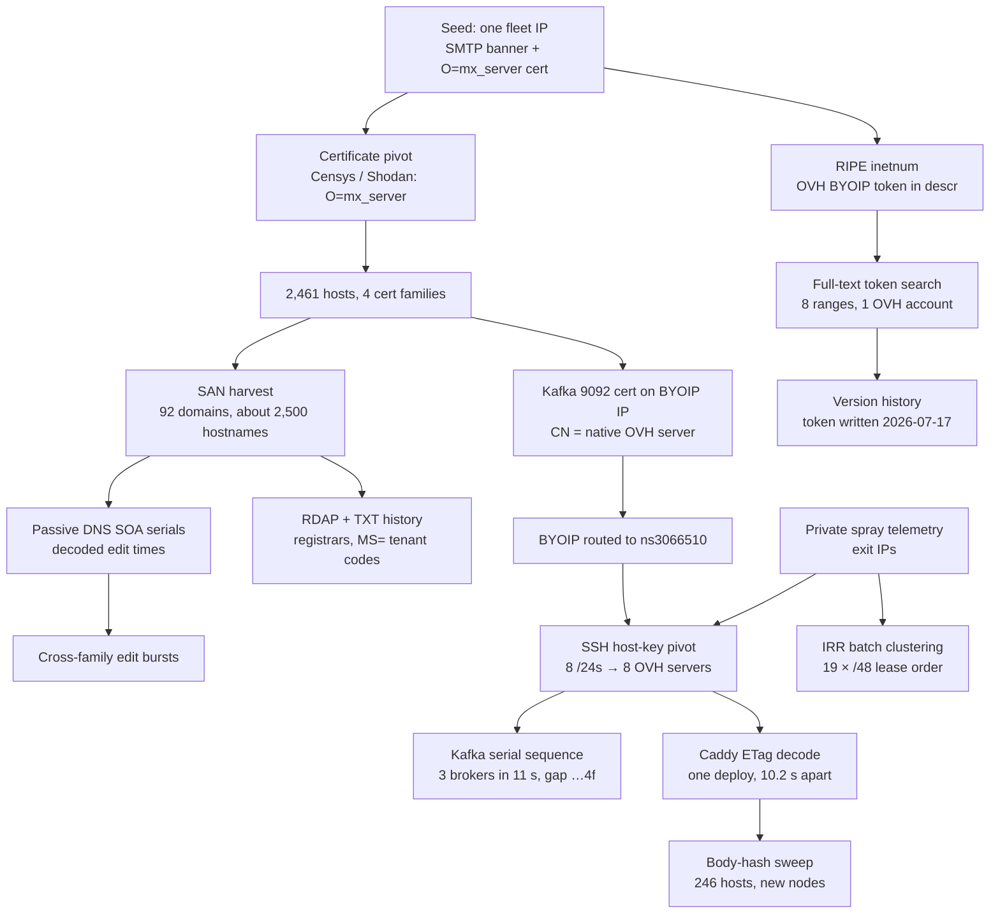

# Pivot methodology

Each step is reproducible with public tools. Queries are in [`../queries/`](../queries/).

## Step by step

1. **Seed.** Start from one fleet IP. Record the SMTP banner, the certificate subject and the issuer.
2. **Certificate pivot.** Search for `O=mx_server`. Group the results by CN to get the certificate families.
3. **SAN harvest.** Pull the SAN lists. Separate the apex domains from the hostnames.
4. **Registry pivot.** For each BYOIP block, read the RIPE inetnum. Extract the `descr` token. Search the token in full text.
5. **Routing pivot.** Use routing history to get announcement start and end dates.
6. **Kafka pivot.** Search for `Kafka-Cluster-CA`. Keep only hits with the fleet AKI. A CN naming another IP shows routing.
7. **DNS timing.** Pull SOA serial history for Cloudflare-hosted fleet zones and decode the edit times.
8. **Domain history.** Use RDAP for registrar and dates, and TXT history for `MS=` and other verification tokens.
9. **Exclusions.** Drop shared infrastructure (Cloudflare edges, shared /24 neighbours, re-leased blocks after 2026-11-12).

## v2.0 steps

10. **SSH host-key pivot.** Map each leased /24 to the server behind it. [ssh-hostkey-front-to-server-mapping.md](ssh-hostkey-front-to-server-mapping.md)
11. **Serial sequence.** Order the private CA's certificates and hunt the gaps. [certificate-serial-sequence-pivot.md](certificate-serial-sequence-pivot.md)
12. **ETag decode.** Turn web ETags into write times to find one deployment run. [caddy-etag-forensics.md](caddy-etag-forensics.md)
13. **Body-hash sweep.** Find nodes the certificate pivot missed. [web-body-hash-sweep.md](web-body-hash-sweep.md)
14. **IRR batch clustering.** Group leased exit prefixes into lease orders. [irr-route-object-batch-clustering.md](irr-route-object-batch-clustering.md)
15. **Sandbox sanity check.** Separate the sandbox's network from the target's. [sandbox-egress-artifacts.md](sandbox-egress-artifacts.md)
